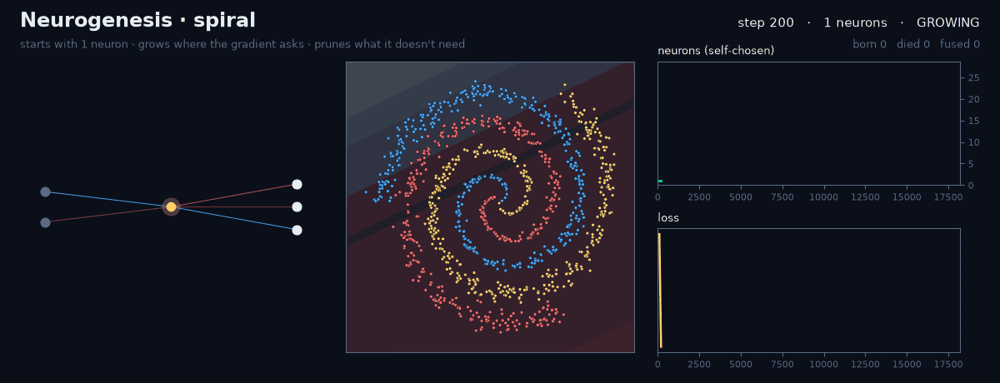
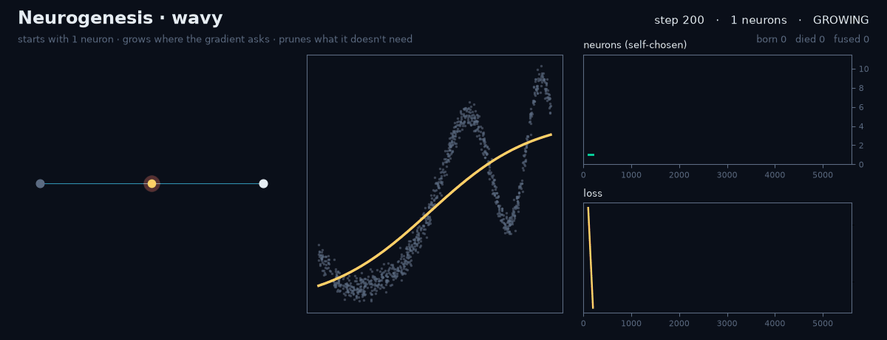
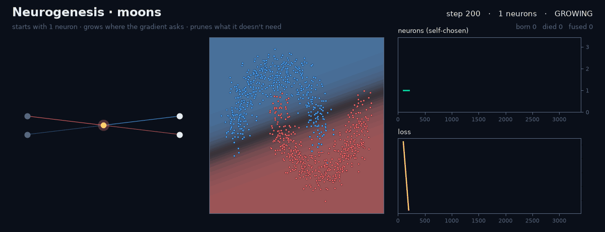
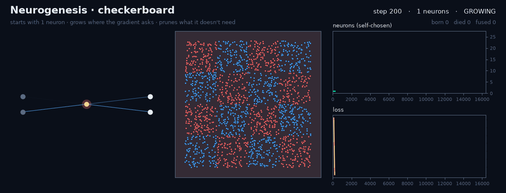

<div align="center">

# 🧠 Neurogenesis

### A neural network that grows its own brain.

**Starts with one neuron. Grows where the gradient asks. Prunes what it doesn't need. Stops when it's done.**

You never choose the number of neurons again.



</div>

---

Every neural network you've ever trained began with a guess: *how wide should this layer be?*
Too small and it can't learn. Too big and you waste compute, memory and time, then you sweep
`[16, 32, 64, 128, 256]` and train five networks to keep one.

**Neurogenesis drops the guess.** The network is born with a single hidden neuron. While it trains,
it runs a life cycle loosely modelled on the brain:

| | Event | What happens |
|---|---|---|
| 🐣 | **Birth** | When learning plateaus, hundreds of candidate neurons **audition**. Each is scored by the exact gradient its outgoing weights would receive, which is how fast it would reduce the loss if hired. The best, mutually-diverse winners are born with **zero outgoing weights**, so a birth **never changes the network's output**. They then learn to contribute. |
| 💀 | **Death** | A neuron whose contribution (activation spread × outgoing weight strength) withers is removed. Its average output moves into the next layer's bias, so the function barely moves. |
| 🔗 | **Fusion** | Two neurons that fire in lock-step (\|corr\| > 0.995) merge into one by linear regression, with almost no change in output. |
| 🌳 | **Maturity** | When growth spurts stop paying off (3 in a row that improve the loss by < 5%), growth stops. The network fine-tunes and **halts on its own**. |

What's left is a network sized to fit **this problem**. Nobody picked the size.

## Quickstart

```bash
pip install numpy matplotlib pillow
python examples/grow.py spiral        # writes assets/spiral.gif
```

```python
from neurogenesis import Neurogenesis
from neurogenesis.datasets import spiral

X, y = spiral()
model = Neurogenesis(verbose=True).fit(X, y)   # no width, no epochs, no early-stopping config

print(model.widths_)        # e.g. [19]  <- chosen by the network
print(model.score(X, y))    # 0.999
print(model.life_story())   # every birth, death and fusion, with the step it happened
```

```
[   500] + birth     L0 n1 pressure=0.2170 -> layer width 3
[   500] + birth     L0 n2 pressure=0.2143 -> layer width 3
[  1200] + birth     L0 n3 pressure=0.1864 -> layer width 5
...
[ 19200] + birth     L0 n22 pressure=0.0045 -> layer width 20
[ 19800] & fusion    L0 n22 -> n21 (corr=-0.996)
[ 20200] * mature    stopped growing at 19 neurons, widths=[19]
[ 20800] # converged loss=0.0096 neurons=19
```

Works for classification and regression (auto-detected), and for any depth (`hidden_layers=3`).
Each spurt grows the layer with the most unexplained gradient. **Pure NumPy, one ~470-line file, no other runtime dependency.**

## It finds the right size, even when the right size is tiny

| Problem | Neurons it chose | Why that's right |
|---|---|---|
| Two concentric circles | **3** | 3 tanh units is the minimum that can enclose a region in 2-D |
| Two moons | 5–14 | a gently curved boundary (4 is enough, so this one over-grows: see benchmark) |
| 1-D chirp regression | ~9 | one unit per bend in the curve |
| 3-arm spiral | ~20 | the classic "hard" toy problem |
| 4×4 checkerboard | ~23 | 16 tiles of axis-aligned edges |

<p align="center"> </p>
<p align="center"></p>

## Benchmark: one run vs. a full width sweep

Every fixed-width MLP uses **the same code, optimiser, activation and depth** and gets the full 30k-step budget.
Neurogenesis starts from 1 neuron, chooses its own size and stops on its own. Test sets are held out, results are averaged over 3 seeds.
Reproduce with `python benchmarks/benchmark.py`.

| dataset | Neurogenesis score | neurons (self-chosen) | steps | best fixed MLP | smallest fixed MLP within 1 pt of Neurogenesis |
|---|---|---|---|---|---|
| spiral | **0.981** ± 0.009 | **22.0** (19–27) | 26933 | 0.988 (w=64) | w=16 (0.978) |
| moons | **0.992** ± 0.003 | **10.7** (5–14) | 9000 | 0.991 (w=4) | w=4 (0.991) |
| circles | **0.997** ± 0.004 | **3.7** (3–5) | 9033 | 0.997 (w=4) | w=4 (0.997) |
| checkerboard | **0.972** ± 0.005 | **22.7** (20–25) | 17933 | 0.979 (w=32) | w=16 (0.974) |
| wavy (regression) | **0.990** ± 0.001 | **8.7** (6–11) | 7400 | 0.990 (w=32) | w=4 (0.987) |

### Fixed-width sweep (mean test score over seeds, 30k steps each)

| dataset | w=2 | w=4 | w=8 | w=16 | w=32 | w=64 | w=128 |
|---|---|---|---|---|---|---|---|
| spiral | 0.522 | 0.621 | 0.839 | 0.978 | 0.987 | 0.988 | 0.984 |
| moons | 0.896 | 0.991 | 0.989 | 0.989 | 0.988 | 0.985 | 0.983 |
| circles | 0.780 | 0.997 | 0.997 | 0.997 | 0.997 | 0.997 | 0.997 |
| checkerboard | 0.582 | 0.722 | 0.869 | 0.974 | 0.979 | 0.977 | 0.979 |
| wavy (regression) | 0.900 | 0.987 | 0.990 | 0.988 | 0.990 | 0.989 | 0.988 |

**How to read this:**
- **The width is a trap.** At w=2–8 the spiral and checkerboard fail badly (52–87%). A bad guess costs you 10–45 points.
- **One run ≈ the whole sweep.** Neurogenesis lands within ~1 point of the best of 7 fixed widths on every task.
  The sweep spends 7 × 30k = 210k training steps. Neurogenesis spends 7k–27k, which is **8–28× fewer steps**.
- **It is not magic.** A width hand-tuned in hindsight is still slightly better on spiral and checkerboard (by 0.7 points),
  and on moons it over-grows (≈11 neurons where 4 suffice). Tighter maturity rules are an open problem and PRs are welcome.

## How the audition works (the core idea)

For a hidden layer with inputs **A** (n × d) and back-propagated error **Δ** at the next layer (n × out),
a new neuron *h = tanh(Aw + b)* with zero fan-out gets this gradient on its fan-out:

$$\nabla_{v}\mathcal{L} = \tfrac{1}{n}\, h^\top \Delta$$

Its norm is the **first-order rate at which hiring this neuron would reduce the loss**. So we:

1. Generate a pool of 512 candidates. A few are the linear-optimal directions (the top singular vectors of
   **Aᵀ Δ**). The rest are random hyperplanes **anchored through real data points**, with random sharpness.
2. Standardise each candidate's activation and score it by ‖ĥᵀΔ‖.
3. Hire the top-k, skipping any candidate that correlates > 0.95 with an existing neuron or another winner.
4. Insert them with zero fan-out, so the output is unchanged (tested to 1e-12). Each parameter keeps its own
   Adam step counter, so newborn weights get correctly bias-corrected updates instead of a shock.

Growth, death and fusion all edit the weights **and the optimiser state** together, so training continues
smoothly through every change of shape.

## Honest notes

- This is a research-grade library, not a framework. It's a dense MLP in NumPy, built to make the idea
  crystal-clear and hackable. The natural next step is a PyTorch port for CNN channels / transformer MLP widths.
- Related work it builds on: Cascade-Correlation (Fahlman & Lebiere, 1990), GradMax (Evci et al., 2022),
  Splitting Steepest Descent (Liu et al., 2019), Taylor pruning (Molchanov et al., 2017). The contribution here is one
  closed loop: audition, function-preserving birth, compensated death, regression fusion and automatic maturity,
  with optimiser state that follows the network as it changes shape.
- The knobs that remain (`plateau_tol`, `min_gain`, `prune_utility`) set how hard the network works to improve, not how big it is.
  Defaults were used for every result above.

## Project layout

```
neurogenesis/core.py      the algorithm (life cycle + Adam-with-surgery)
neurogenesis/viz.py       recorder + GIF renderer
neurogenesis/datasets.py  dependency-free toy datasets
examples/grow.py          make the animations
benchmarks/benchmark.py   the comparison above
tests/                    function-preservation and bookkeeping tests (pytest)
```

## License

MIT
