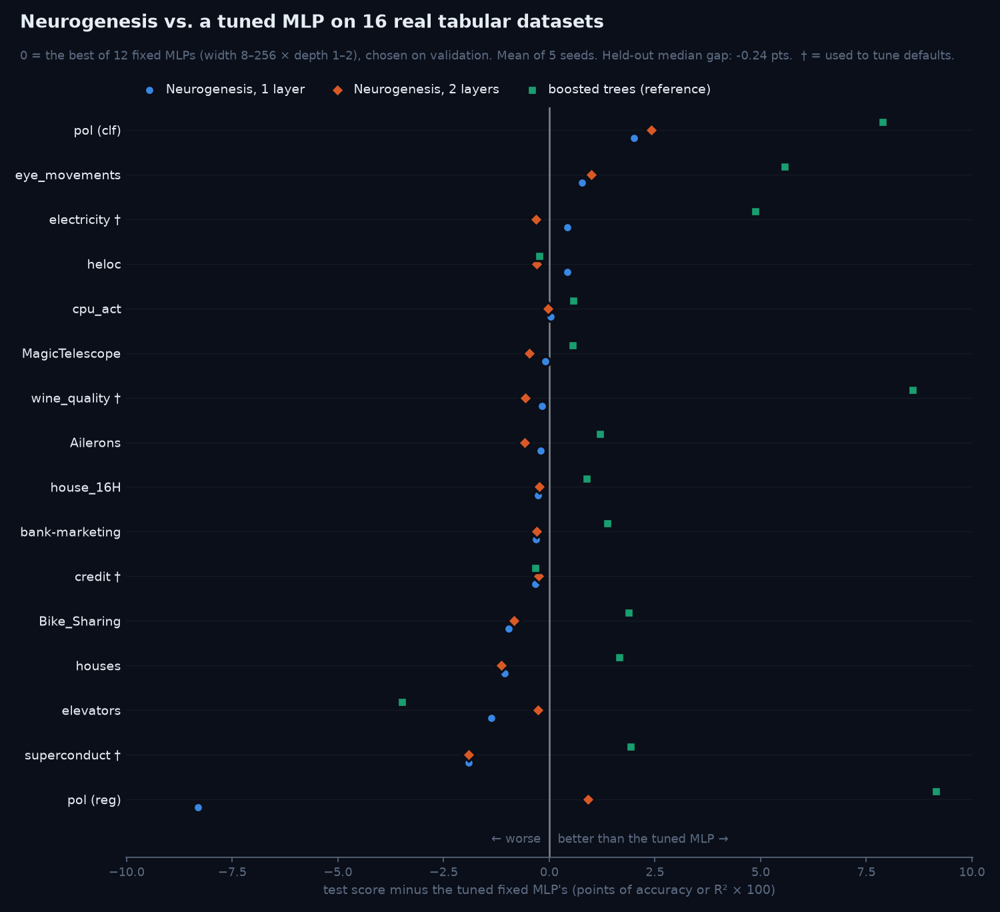
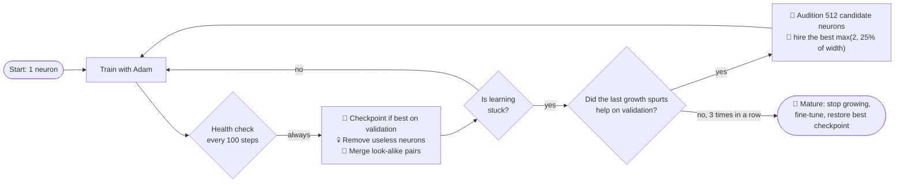
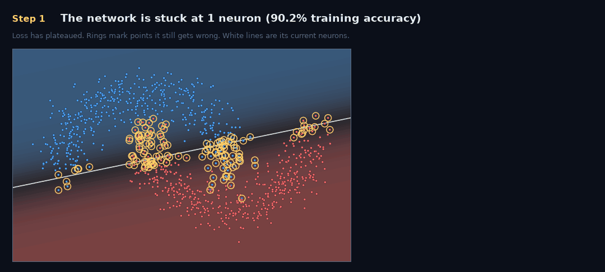
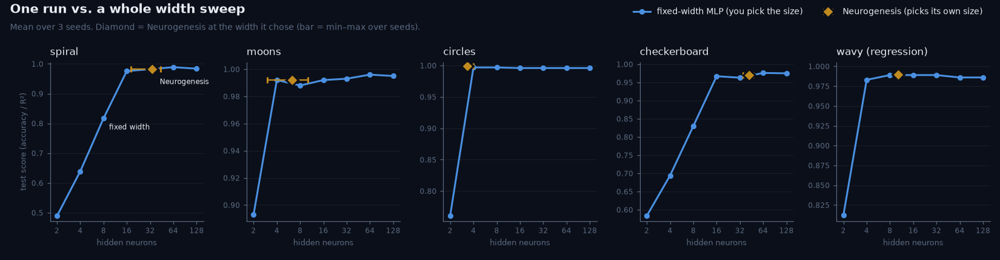

<div align="center">

# 🧠 Neurogenesis

### A neural network that grows its own brain.

**Starts with one neuron · grows where the error asks · prunes what it doesn't need · stops on its own**

[](https://github.com/madhavbuilds/neurogenesis/actions/workflows/tests.yml)
[](LICENSE)


</div>

---

## The idea in 30 seconds

Every neural network starts with a guess: **how many neurons should it have?**
Guess too few and it can't learn. Guess too many and you waste time and compute.
So people train many sizes and keep the best one.

**Neurogenesis skips the guess.** It starts with **one** neuron, and while it trains:

- 🐣 when it gets **stuck**, it **adds** the new neurons that would help most,
- 💀 neurons that **do nothing** are **removed**,
- 🔗 neurons that **do the same job** are **merged**,
- 🌳 when growing stops helping **on held-out data**, it **stops growing** and keeps its best version.

Think of a plant that grows only the branches it needs, instead of you deciding its shape up front.

## Quickstart

```bash
git clone https://github.com/madhavbuilds/neurogenesis && cd neurogenesis
pip install -e ".[viz]"
python examples/grow.py spiral           # renders assets/spiral.gif
```

```python
from neurogenesis import Neurogenesis
from neurogenesis.datasets import spiral

X, y = spiral()
model = Neurogenesis(random_state=0).fit(X, y)   # no width, no epochs, no early-stopping config

model.widths_         # [22]   <- the network chose this
model.score(X, y)     # 1.0
model.predict(X[:5])
print(model.life_story())   # every birth, death and fusion, with the step it happened
```

```
Neurogenesis: 22 neurons [22], 135 params, 18200 steps | births=26 deaths=5 fusions=0
[   700] + birth     L0 n1 pressure=0.2958 -> layer width 3
[   700] + birth     L0 n2 pressure=0.2367 -> layer width 3
[  1400] + birth     L0 n3 pressure=0.2856 -> layer width 5
...
[ 17600] * mature    stopped growing at 22 neurons, widths=[22]
[ 18200] # converged loss=0.0078 val_loss=0.0324 neurons=22
[ 18200] < restore   best validation checkpoint from step 17600: val_loss=0.0110, widths=[22]
```

It works for classification and regression (auto-detected, or pass `task=`), with any number of hidden layers.
The core is **pure NumPy, in one readable file**. It also plugs into scikit-learn (`clone`, `cross_val_score`, `GridSearchCV`)
and saves to a plain `.npz` file (`model.save(path)`, `Neurogenesis.load(path)`).

## Does it work on real data?

We tested it on **16 real tabular datasets** from the standard benchmark of
[Grinsztajn et al. (NeurIPS 2022)](https://arxiv.org/abs/2207.08815), 5 seeds each, about 1,500 training runs.
Four datasets (†) were used to tune the defaults. **All statistics below use only the other 12.**



The opponent is the thing you'd actually do: train **12 fixed-size networks** (width 8–256, depth 1–2) and keep the one with
the best validation score. Every network shares the same code, optimizer, early stopping and checkpoint restore.

| on the 12 held-out datasets | result |
|---|---|
| **One Neurogenesis run vs. the tuned 12-network sweep** | median gap **−0.24 points**, not statistically significant (Wilcoxon p = 0.30) |
| **The 2-layer version vs. the sweep** | mean score **0.816 vs 0.816** (p = 0.57) |
| **Cost** | about **one** training run, so **17.7× less wall-clock** than the sweep (median; range 11–45×) |

**What this shows, honestly:**

- ✅ **It removes the size guess without losing accuracy.** One run lands where a 12-model sweep lands, for the price of one model.
- ✅ **It never picks a badly wrong size.** It's clearly better than the extremes (8×1: p = 0.021; 256×2: p = 0.027).
- ⚠️ **But on these datasets, size barely matters.** With early stopping, every fixed size we tried except those two extremes is statistically indistinguishable from Neurogenesis.
  The value is not having to know that in advance. On problems where size *does* matter, like the toy problems below, picking wrong costs up to 50 points.
- ⚠️ **Growing doesn't beat training the final size from scratch** (+0.02 median, p = 0.73). The win is *finding* the size, not the growing itself.
- ⚠️ **The audition probably helps, but it's not proven.** It beats hiring random candidates on 5 datasets, ties on 5 and loses on 2 (+0.41 mean, p = 0.11).
  Pruning and fusion make no measurable difference to accuracy here.
- ⚠️ **One layer can be too shallow.** On pol (reg) it's 8 points behind; the 2-layer version is 1 point ahead. Try `hidden_layers=2`.
- ❌ **Gradient-boosted trees still win** on 10 of 12 datasets, by 1.3–1.6 points (median) against both Neurogenesis and the tuned MLP. That's the finding of the benchmark's own paper, and it holds.

Full tables, including every fixed size and the ablations: [`benchmarks/real_results.md`](benchmarks/real_results.md).
Reproduce: `pip install -e ".[bench]" && python benchmarks/real_data.py` (about 30 minutes on 8 cores).

## How it works



### The audition: how new neurons are chosen

When the network is stuck, it doesn't add random neurons. It **auditions** them.
In a 2-D problem, each candidate neuron is simply a **line** through the data:

<p align="center"></p>

1. **Stuck.** The network has plateaued. The ringed points are the ones it still gets wrong.
2. **Propose.** 512 candidate neurons are generated, most of them drawn through real data points.
3. **Score.** Each candidate is scored by *how much of the remaining error it can explain that the current neurons can't*.
   Technically: project out what the layer can already express, then measure how well the rest lines up with the error signal.
4. **Hire.** The winners join with **outgoing weights set to zero**, so the network's output does not change at the moment of birth (tested to 1e-12).
   Each winner is scored against the ones hired before it, so there are no look-alikes.
5. **Learn.** Training continues and the new neurons start contributing. In this real run, training accuracy went from 90.2% to 98.8%.

Everything in that animation is computed by the library. Reproduce it with `python examples/explain_audition.py`.
The math, step by step: [docs/HOW_IT_WORKS.md](docs/HOW_IT_WORKS.md).

### The life events

| | Event | When | What happens | Why it's safe |
|---|---|---|---|---|
| 🐣 | **Birth** | training loss plateaus | the best audition winners join | zero outgoing weights → output unchanged |
| 💀 | **Death** | a neuron's *activation spread × outgoing weight strength* falls below 5% of the layer average | it's removed | its average output moves into the next layer's bias |
| 🔗 | **Fusion** | two neurons fire in lock-step (\|corr\| > 0.995) | one is folded into the other by linear regression | output nearly unchanged |
| 🌳 | **Maturity** | 3 growth spurts in a row each improve the **validation** loss by < 1% | growth stops, then training halts at the next plateau | — |
| 🛑 | **Early stop** | no new best validation loss for 2,000 steps | training halts | — |
| ⏪ | **Restore** | end of training | the best validation checkpoint comes back | rolls back growth that didn't help |

New neurons are protected from death and fusion for their first 600 steps.
Each weight keeps its **own Adam step counter**, so newborn weights get properly scaled updates.
With several hidden layers, the layer whose best candidate explains the largest *share* of its error signal gets the new neurons.
That share is scale-invariant, which fixed v0.1's habit of collapsing deep networks into 1-neuron bottlenecks
(spiral, 2 layers: `[35, 1]` → `[21, 8]`; 3 layers: test accuracy 92.2% → 97.7%, mean of 3 seeds).

## Toy benchmark: when the size really matters

On small 2-D problems, the wrong size is a disaster, and that's where self-sizing shines.
Every fixed-width MLP uses the same code, optimizer, early stopping and depth. Held-out test sets, 3 seeds.



| dataset | Neurogenesis | neurons it chose | best fixed MLP | smallest fixed MLP within 1 pt |
|---|---|---|---|---|
| spiral | 0.982 ± 0.003 | 34.3 (18–44) | 0.989 (w=64) | w=16 |
| moons | 0.992 ± 0.006 | 6.3 (3–10) | 0.996 (w=64) | w=4 |
| circles | 0.999 ± 0.002 | 3.3 (3–4) | 0.997 (w=4) | w=4 |
| checkerboard | 0.970 ± 0.004 | 42.0 (35–48) | 0.976 (w=64) | w=16 |
| wavy (R²) | 0.990 ± 0.001 | 10.3 (10–11) | 0.989 (w=32) | w=4 |

- ✅ **Picking the wrong size hurts a lot here.** At 2–8 neurons, spiral and checkerboard score 49–83%.
- ✅ **One run ≈ the best of the sweep.** Within 0.7 points of the best of 7 sizes on every task.
- ✅ **It finds tiny solutions when they exist.** 3 neurons on circles, 3–10 on moons.
- ⚠️ **It over-grows when growth is cheap.** Spiral and checkerboard end at 34–42 neurons where 16 are within 1 point.
  That's the price of geometric growth (`grow_frac=0.25`), which real data needs. `grow_frac=0, min_gain=0.05` gives smaller networks (~20 on spiral).

Full numbers: [`benchmarks/results.md`](benchmarks/results.md). Reproduce with `python benchmarks/benchmark.py` (about 5 minutes).

## Is this new?

**Mostly no, and we'd rather say so up front.** Every building block has a published ancestor:

| Neurogenesis piece | Prior work |
|---|---|
| Grow when the error stops falling | Dynamic Node Creation (Ash, 1989) |
| A candidate pool scored against the remaining error | Cascade-Correlation (Fahlman & Lebiere, 1989/90) |
| Scoring what a candidate adds beyond existing units | Neglected-nonlinearity test (Lee, White & Granger, 1993); orthogonal matching pursuit |
| Gradient-maximizing new neurons, SVD seeding, zero outgoing weights | GradMax (Evci et al., ICLR 2022); Net2Net (2016); Network Morphism (2016) |
| When / where / how to add neurons | NORTH (Maile et al., AutoML 2022); Self-Expanding NNs (Mitchell et al., 2023) |
| Optimal fixes for capacity bottlenecks | TINY (Verbockhaven et al., TMLR 2024) |
| Learning width end-to-end | Adaptive Width Neural Networks (Errica et al., ICLR 2026) |
| Grow, then prune | NeST (Dai, Yin & Jha) |

What Neurogenesis offers is a **small, readable, closed-loop implementation** of these ideas, plus an **honest real-data evaluation**
with the controls that matter (a tuned sweep, untuned defaults, the same architecture from scratch, ablations and a tree baseline).
It has not yet been compared head-to-head with the growth methods above. See [docs/RESEARCH_ROADMAP.md](docs/RESEARCH_ROADMAP.md).

## Known limitations

- **It doesn't beat a sensible fixed size on tabular data**, and trees beat both (see above).
- **Dense MLPs on NumPy, CPU only.** No GPU, no convolutional or attention models (yet).
- **Some churn.** On checkerboard it made 150 births and 107 deaths to end at 42 neurons. It works, but it isn't economical.
- **Integer-valued float targets** with 32 or fewer unique values are treated as classification. Pass `task="regression"` for counts or ratings.
- **Tested on 16 real datasets with 5 seeds.** A larger, frozen-code confirmation (TabArena) is still to do.

## API

```python
Neurogenesis(
    hidden_layers=1,        # depth is fixed; width is learned. 2 is often better on real data
    init_width=1,           # neurons each hidden layer starts with (int, or one per layer)
    max_width=128,          # hard cap per layer
    learning_rate=0.01, batch_size=128, max_steps=30_000,
    check_every=100,        # steps between health checks
    plateau_window=4, plateau_tol=0.03,   # "stuck" = training loss improved < 3% over 4 checks
    grow_k=2, grow_frac=0.25,             # a spurt hires max(grow_k, grow_frac × width)
    candidates=512,                       # audition pool size
    min_gain=0.01, maturity_patience=3,   # stop growing after 3 spurts that each gain < 1% on validation
    prune_utility=0.05, fuse_corr=0.995, min_age=600,   # 0 / 1.0 disable death / fusion
    weight_decay=1e-4,
    validation_fraction=0.1,  # held out to judge growth, early-stop and pick the best checkpoint
    patience=20,              # health checks without a validation improvement before stopping (0 = off)
    restore_best=True,        # return the best validation checkpoint
    audition="gradient",      # or "random" (ablation)
    task="auto",              # or "classification" / "regression"
    static=False,             # True = plain fixed-width MLP with the same training (used as the baseline)
    random_state=None, verbose=False,
)
```

| Method / attribute | |
|---|---|
| `fit(X, y, callback=None, eval_set=None)` | train and grow. `eval_set=(X_val, y_val)` replaces the internal split. `callback(model, step, loss)` runs at every health check |
| `predict`, `predict_proba`, `score` | the usual (`score` = accuracy or R²) |
| `save(path)`, `Neurogenesis.load(path)` | NumPy `.npz`, no pickle |
| `get_params`, `set_params` | scikit-learn protocol: works with `clone`, `cross_val_score`, `GridSearchCV` |
| `widths_`, `n_neurons_`, `n_params_`, `n_steps_` | the size it chose and how long it trained |
| `flops_`, `best_val_loss_` | analytic training FLOPs (including auditions), best validation loss |
| `events_`, `life_story()` | every birth, death, fusion, maturity, stop and restore event |
| `history_` | training loss, validation loss, neuron count and widths at every check |

Make your own animation:

```python
from neurogenesis.viz import grow_and_render
grow_and_render(Neurogenesis(random_state=0), X, y, "my_run.gif")
```

## Reproduce everything

| Command | Produces |
|---|---|
| `pytest` | 21 tests: output-preserving birth, lossless fusion and death, checkpoint restore, no deep bottlenecks, save/load, scikit-learn compatibility, input validation |
| `python benchmarks/real_data.py` | `benchmarks/real_results.{json,md}` (needs `.[bench]`; downloads from OpenML once) |
| `python benchmarks/plot_real.py` | `assets/real_benchmark.png` |
| `python benchmarks/benchmark.py` | `benchmarks/results.md` |
| `python benchmarks/plot_results.py` | `assets/benchmark.png` |
| `python examples/grow.py {spiral,moons,circles,checkerboard,wavy}` | `assets/<name>.gif` |
| `python examples/explain_audition.py` | `assets/audition.gif` |

All runs are seeded and deterministic on a given machine. The raw results of every real-data run are in `benchmarks/real_results.json`.

## Project layout

```
neurogenesis/
  core.py        the algorithm: life cycle + Adam that survives shape changes
  viz.py         recorder and GIF renderer
  datasets.py    dependency-free toy datasets
examples/        animations (grow.py, explain_audition.py)
benchmarks/      toy and real-data benchmarks, plus the charts
docs/            HOW_IT_WORKS.md (math), RESEARCH_ROADMAP.md (what's next)
tests/           pytest suite
```

## Contributing

PRs are very welcome, especially head-to-head comparisons with other growth methods and more real data.
See [CONTRIBUTING.md](CONTRIBUTING.md) and the [roadmap](docs/RESEARCH_ROADMAP.md).

## Citation

If this is useful in your work, please cite it with [CITATION.cff](CITATION.cff) and the original papers listed above.

## License

[MIT](LICENSE) © 2026 Madhav Panchal
