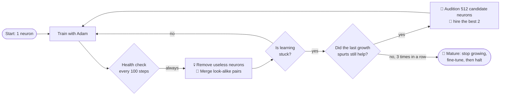

<div align="center">

# 🧠 Neurogenesis

### A neural network that grows its own brain.

**Starts with one neuron · grows where the gradient asks · prunes what it doesn't need · stops on its own**

[](https://github.com/madhavbuilds/neurogenesis/actions/workflows/tests.yml)
[](LICENSE)


</div>

---

## The idea in 30 seconds

Every neural network starts with a guess: **how many neurons should it have?**
Guess too few and it can't learn. Guess too many and you waste time and compute.
So people train many sizes and keep the best one.

**Neurogenesis skips the guess.** It starts with **one** neuron, and while it trains:

- 🐣 when it gets **stuck**, it **adds** the new neurons that would help most,
- 💀 neurons that **do nothing** are **removed**,
- 🔗 neurons that **do the same job** are **merged**,
- 🌳 when adding more stops helping, it **stops growing**.

Think of a plant that grows only the branches it needs, instead of you deciding its shape up front.

## Quickstart

```bash
git clone https://github.com/madhavbuilds/neurogenesis && cd neurogenesis
pip install -e ".[viz]"
python examples/grow.py spiral           # renders assets/spiral.gif
```

```python
from neurogenesis import Neurogenesis
from neurogenesis.datasets import spiral

X, y = spiral()
model = Neurogenesis(random_state=0).fit(X, y)   # no width, no epochs, no early-stopping config

model.widths_         # [19]   <- the network chose this
model.score(X, y)     # 0.999
model.predict(X[:5])
print(model.life_story())   # every birth, death and fusion, with the step it happened
```

```
Neurogenesis: 19 neurons [19], 117 params, 20800 steps | births=22 deaths=2 fusions=2
[   500] + birth     L0 n1 pressure=0.2170 -> layer width 3
[   500] + birth     L0 n2 pressure=0.2143 -> layer width 3
[  1200] + birth     L0 n3 pressure=0.1864 -> layer width 5
...
[ 19800] & fusion    L0 n22 -> n21 (corr=-0.996)
[ 20200] * mature    stopped growing at 19 neurons, widths=[19]
[ 20800] # converged loss=0.0096 neurons=19
```

It works for classification and regression (auto-detected, or pass `task=`).
The core is **pure NumPy, in one readable file**.

## How it works



### The audition: how new neurons are chosen

When the network is stuck, it doesn't add random neurons. It **auditions** them.
In a 2-D problem, each candidate neuron is simply a **line** through the data:

<p align="center"></p>

1. **Stuck.** The network has plateaued. The ringed points are the ones it still gets wrong.
2. **Propose.** 512 candidate neurons are generated, most of them drawn through real data points.
3. **Score.** Each candidate is scored by *how fast it would reduce the error if hired*.
   That is the size of the gradient its outgoing weights would receive.
4. **Hire.** The top 2 that don't duplicate existing neurons join with **outgoing weights set to zero**,
   so the network's output does not change at the moment of birth (tested to 1e-12).
5. **Learn.** Training continues and the new neurons start contributing. In this real run, training accuracy went from 90.2% to 99.0%.

Everything in that animation is computed by the library. Reproduce it with `python examples/explain_audition.py`.

### The four life events

| | Event | When | What happens | Why it's safe |
|---|---|---|---|---|
| 🐣 | **Birth** | learning plateaus | the best audition winners join | zero outgoing weights → output unchanged |
| 💀 | **Death** | a neuron's *activation spread × outgoing weight strength* falls below 5% of the layer average | it's removed | its average output moves into the next layer's bias |
| 🔗 | **Fusion** | two neurons fire in lock-step (\|corr\| > 0.995) | one is folded into the other by linear regression | output nearly unchanged |
| 🌳 | **Maturity** | 3 growth spurts in a row each improve the loss by < 5% | growth stops, then training halts at the next plateau | — |

New neurons are protected from death and fusion for their first 600 steps.
Each weight keeps its **own Adam step counter**, so newborn weights get properly scaled first updates.

For the math, see **[docs/HOW_IT_WORKS.md](docs/HOW_IT_WORKS.md)**.

## Watch it learn

| 1-D regression: fits a chirp with 9 neurons | Two moons |
|---|---|
|  |  |


## Benchmark: one run vs. a whole width sweep

Every fixed-width MLP uses the **same code, optimiser, activation and depth**, and gets a full 30k-step budget.
Neurogenesis starts from 1 neuron, picks its own size and stops on its own.
Scores are on held-out test sets, averaged over 3 seeds.


| dataset | Neurogenesis | neurons it chose | best fixed MLP | smallest fixed MLP within 1 pt |
|---|---|---|---|---|
| spiral | 0.981 ± 0.009 | 22.0 (19–27) | 0.988 (w=64) | w=16 |
| moons | 0.992 ± 0.003 | 10.7 (5–14) | 0.991 (w=4) | w=4 |
| circles | 0.997 ± 0.004 | 3.7 (3–5) | 0.997 (w=4) | w=4 |
| checkerboard | 0.972 ± 0.005 | 22.7 (20–25) | 0.979 (w=32) | w=16 |
| wavy (R²) | 0.990 ± 0.001 | 8.7 (6–11) | 0.990 (w=32) | w=4 |

**What this shows, honestly:**

- ✅ **Picking the wrong size hurts a lot.** At 2–8 neurons, spiral and checkerboard score 52–87%.
- ✅ **One run ≈ the best of the sweep.** Neurogenesis lands within about 1 point of the best of 7 sizes on every task,
  using 7k–27k training steps, against the 210k the sweep needs.
- ✅ **It can find tiny solutions.** On circles it stopped at 3 neurons in 2 of 3 seeds.
- ⚠️ **It doesn't beat a well-chosen size.** The best hand-picked width is still about 0.7 points better on spiral and checkerboard.
- ⚠️ **It can over-grow.** On moons it used ~11 neurons where 4 are enough.
- ⚠️ **Toy data only, so far.** These are 2-D/1-D synthetic problems. Real-data benchmarks are the top item on the [roadmap](docs/RESEARCH_ROADMAP.md).

Full numbers: [`benchmarks/results.md`](benchmarks/results.md). Reproduce them with `python benchmarks/benchmark.py` (about 5 minutes on a laptop).

## Is this new?

**Mostly no, and we'd rather say so up front.** Every building block has a published ancestor:

| Neurogenesis piece | Prior work |
|---|---|
| Grow when the error stops falling | Dynamic Node Creation (Ash, 1989) |
| A candidate pool scored against the remaining error | Cascade-Correlation (Fahlman & Lebiere, 1989/90) |
| Gradient-maximizing new neurons, SVD seeding, zero outgoing weights | GradMax (Evci et al., ICLR 2022); Net2Net (2016); Network Morphism (2016) |
| When / where / how to add neurons | NORTH (Maile et al., AutoML 2022); Self-Expanding NNs (Mitchell et al., 2023) |
| Optimal fixes for capacity bottlenecks | TINY (Verbockhaven et al., TMLR 2024) |
| Learning width end-to-end | Adaptive Width Neural Networks (Errica et al., ICLR 2026) |
| Grow, then prune | NeST (Dai, Yin & Jha) |

What Neurogenesis offers is a **small, readable, closed-loop implementation**: audition, output-preserving birth,
death with bias compensation, regression-based fusion and automatic maturity, with optimizer state that follows every change in shape.
It's a good place to learn, experiment and build on. See [docs/RESEARCH_ROADMAP.md](docs/RESEARCH_ROADMAP.md)
for what would make it a research contribution.

## Known limitations

- **One hidden layer is the tested setting.** With `hidden_layers>1`, growth can get stuck in upstream layers and leave a
  1-neuron bottleneck (example: widths `[10, 10, 1]` on spiral). The cause is diagnosed in the roadmap, and fixing it is high on the list.
- **Growth decisions use training data.** There's no validation split yet, so on noisy data it may over-grow.
- **Dense MLPs on NumPy, CPU only.** No GPU, no convolutional or attention models (yet).
- **Integer-valued float targets** with 32 or fewer unique values are treated as classification. Pass `task="regression"` for counts or ratings.

## API

```python
Neurogenesis(
    hidden_layers=1,        # depth is fixed; width is learned (1 layer is the tested setting)
    init_width=1,           # neurons each hidden layer starts with
    max_width=128,          # hard cap per layer
    learning_rate=0.01, batch_size=128, max_steps=30_000,
    check_every=100,        # steps between health checks
    plateau_window=4, plateau_tol=0.03,   # "stuck" = < 3% improvement over 4 checks
    grow_k=2, candidates=512,             # hires per spurt, audition pool size
    min_gain=0.05, maturity_patience=3,   # when to stop growing
    prune_utility=0.05, fuse_corr=0.995, min_age=600,
    weight_decay=1e-4,
    task="auto",            # or "classification" / "regression"
    static=False,           # True = plain fixed-width MLP (used as the benchmark baseline)
    random_state=None, verbose=False,
)
```

| Method / attribute | |
|---|---|
| `fit(X, y, callback=None)` | train and grow. `callback(model, step, loss)` runs at every health check |
| `predict`, `predict_proba`, `score` | the usual (`score` = accuracy or R²) |
| `widths_`, `n_neurons_`, `n_params_`, `n_steps_` | the size it chose and how long it trained |
| `events_`, `life_story()` | every birth, death, fusion and maturity event |
| `history_` | loss, neuron count and widths at every check |

Make your own animation:

```python
from neurogenesis.viz import grow_and_render
grow_and_render(Neurogenesis(random_state=0), X, y, "my_run.gif")
```

## Reproduce everything

| Command | Produces |
|---|---|
| `pytest` | 9 tests: output-preserving birth, lossless fusion, optimizer bookkeeping, input validation |
| `python examples/grow.py {spiral,moons,circles,checkerboard,wavy}` | `assets/<name>.gif` |
| `python examples/explain_audition.py` | `assets/audition.gif` |
| `python benchmarks/benchmark.py` | `benchmarks/results.md` |
| `python benchmarks/plot_results.py` | `assets/benchmark.png` |

All runs are seeded and deterministic on a given machine.

## Project layout

```
neurogenesis/
  core.py        the algorithm: life cycle + Adam that survives shape changes
  viz.py         recorder and GIF renderer
  datasets.py    dependency-free toy datasets
examples/        animations (grow.py, explain_audition.py)
benchmarks/      comparison against fixed widths, plus the chart
docs/            HOW_IT_WORKS.md (math), RESEARCH_ROADMAP.md (what's next)
tests/           pytest suite
```

## Contributing

PRs are very welcome, especially on the roadmap's top items: real-data benchmarks, validation-based stopping,
and the multi-layer fix. See [CONTRIBUTING.md](CONTRIBUTING.md).

## Citation

If this is useful in your work, please cite it with [CITATION.cff](CITATION.cff) and the original papers listed above.

## License

[MIT](LICENSE) © 2026 Madhav Panchal
