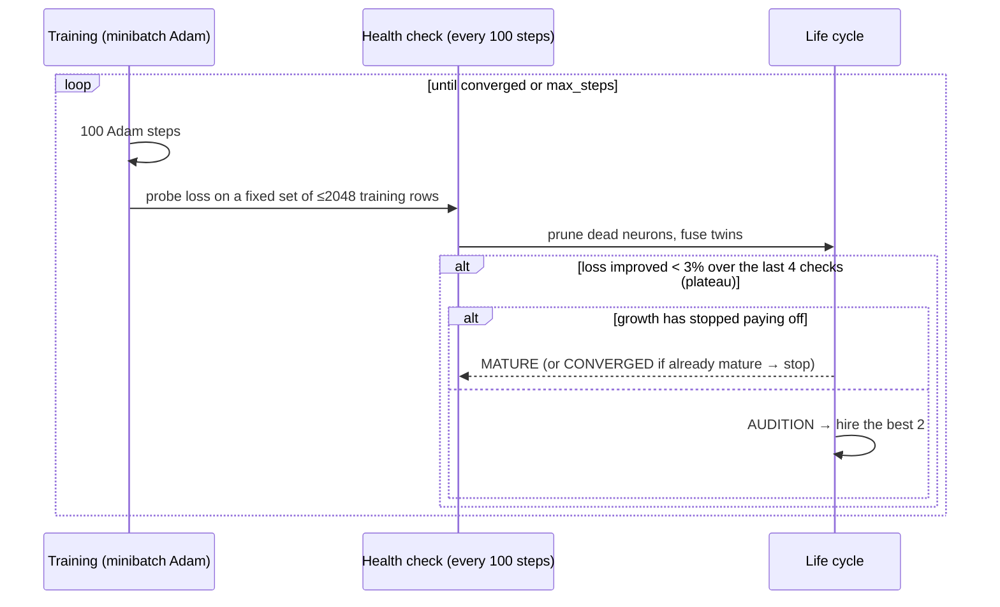

# How Neurogenesis works

This page walks through the algorithm from simple to precise. The code lives in
[`neurogenesis/core.py`](../neurogenesis/core.py), and each section names the function that implements it.

## 1. The model

A plain multilayer perceptron (MLP):

```
x ──► [ tanh layer, width w₁ ] ──► … ──► [ linear output ] ──► softmax (classification) or identity (regression)
```

- Inputs are standardized, and regression targets too.
- Loss: cross-entropy for classification, ½·MSE for regression.
- Optimizer: Adam with decoupled weight decay. **Each weight has its own step counter**,
  so a weight born at step 10,000 is bias-corrected as if it were at step 1. (`_Param.adam`)

Only the **widths** change during training. Depth is fixed.

## 2. The training loop (`fit`)



## 3. Birth: the audition (`_candidate_pool`, `_select`, `_grow`)

Take a hidden layer. Let

- **A** (n × d) be the inputs to that layer on the probe set,
- **Δ** (n × k) be ∂Loss/∂(pre-activations of the *next* layer). This is the error signal flowing back.

A candidate neuron computes **h = tanh(A w + b)**. Suppose it joins with outgoing weights **v = 0**.
Then the network's output is unchanged, but the gradient on its outgoing weights is

$$\nabla_v \mathcal{L} = h^\top \Delta$$

(Δ already includes the 1/n average). Under gradient descent, the loss initially falls at a rate of ‖∇ᵥℒ‖².
So **‖hᵀΔ‖ measures how useful the neuron would be the moment it's hired.**
To compare candidates fairly, *h* is standardized first (zero mean, unit variance).

**Building the pool (512 candidates):**

1. **Linear seeds.** The top singular vectors of (A − Ā)ᵀΔ. These are the directions that would be optimal if tanh were linear (this is GradMax's idea).
2. **Anchored random hyperplanes.** A random direction w, with a random sharpness between 0.5 and 4, and a bias chosen so the hyperplane passes **through a real data point**. In 2-D, these are the lines in the audition animation.

**Choosing winners:** sort by score, then greedily accept candidates that

- aren't flat (activation std > 1e-3),
- don't correlate > 0.95 with an existing neuron,
- don't correlate > 0.95 with an already-chosen winner.

If there are several hidden layers, the layer whose best candidate scores highest gets the new neurons.
*Known issue:* scores aren't comparable across layers (see the roadmap).

## 4. Death (`_prune_and_fuse`, `_remove`)

For neuron j with activation h_j and outgoing weight row v_j:

$$u_j = \operatorname{std}(h_j)\cdot\lVert v_j\rVert, \qquad \text{die if } \frac{u_j}{\operatorname{mean}(u)} < 0.05$$

A neuron that barely varies, or whose outgoing weights have withered (weight decay helps here), contributes almost nothing.
Before removal, its **average** output is added into the next layer's bias, so the function shifts by only the neuron's variance contribution.

## 5. Fusion

If two neurons a and b have |corr(h_a, h_b)| > 0.995, regress h_b ≈ c·h_a + d, then

$$v_a \leftarrow v_a + c\,v_b, \qquad \text{bias}_{next} \leftarrow \text{bias}_{next} + d\,v_b$$

and delete b. When h_b is exactly an affine function of h_a, this is exact (the test suite checks it to 1e-6).

## 6. When to stop growing

After each growth spurt, the loss at the *next* plateau is compared with the loss at the spurt:

- gain < 5% → a **strike**; a good spurt resets the strikes;
- 3 strikes in a row, or ≥ 99.9% probe accuracy with loss < 0.05, or `max_width` reached → **mature**;
- once mature, the next plateau → **converged**, and training stops.

## 7. Guarantees and their limits

| Property | Status |
|---|---|
| Birth leaves the output unchanged | exact (tested, 1e-12) |
| Fusion of an exact affine duplicate is lossless | tested (1e-6) |
| Death changes the output only slightly | small by construction, not zero (tested < 0.05 mean prob change) |
| Optimizer state always matches the parameter shapes | tested |
| The final size is optimal | **not guaranteed.** It's a heuristic stopping rule on training data |
| Multi-layer placement is sensible | **not guaranteed** (known bottleneck failure) |
