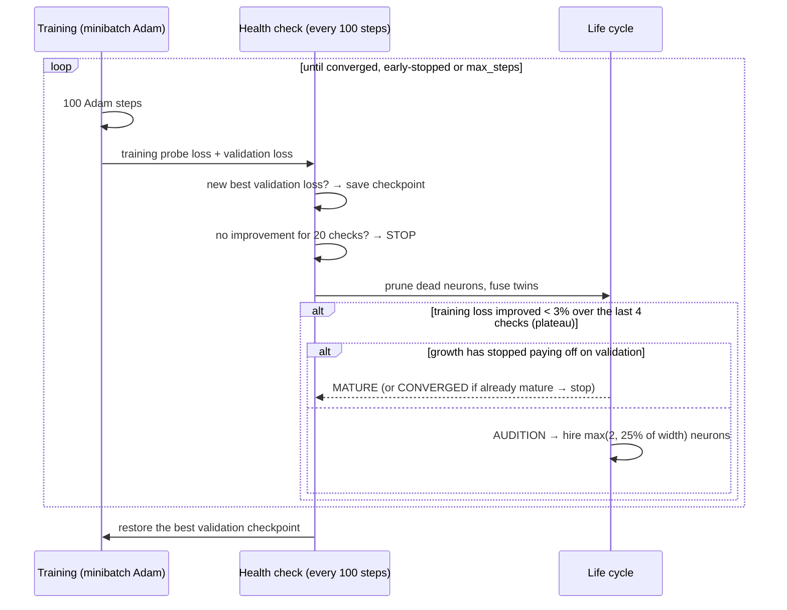

# How Neurogenesis works

This page walks through the algorithm from simple to precise. The code lives in
[`neurogenesis/core.py`](../neurogenesis/core.py), and each section names the function that implements it.

## 1. The model

A plain multilayer perceptron (MLP):

```
x ──► [ tanh layer, width w₁ ] ──► … ──► [ linear output ] ──► softmax (classification) or identity (regression)
```

- Inputs are standardized, and regression targets too.
- Loss: cross-entropy for classification, ½·MSE for regression.
- Optimizer: Adam with decoupled weight decay. **Each weight has its own step counter**,
  so a weight born at step 10,000 is bias-corrected as if it were at step 1. (`_Param.adam`)

Only the **widths** change during training. Depth is fixed.

## 2. The training loop (`fit`)

Before training, 10% of the data is held out as a **validation set** (stratified for classification;
pass `eval_set=(X_val, y_val)` to use your own). Two different signals drive the life cycle:

- the **training probe loss** (≤ 2048 fixed training rows) answers *"is learning stuck?"*
- the **validation loss** answers *"did growing actually help?"*, *"should we stop?"* and *"which version do we keep?"*



## 3. Birth: the audition (`_candidate_pool`, `_select`, `_grow`)

Take a hidden layer. Let

- **A** (n × d) be the inputs to that layer on the probe set,
- **H** (n × w) be the layer's current activations,
- **Δ** (n × k) be ∂Loss/∂(pre-activations of the *next* layer). This is the error signal flowing back.

A candidate neuron computes **h = tanh(A w + b)**. Suppose it joins with outgoing weights **v = 0**.
Then the network's output is unchanged, but the gradient on its outgoing weights is

$$\nabla_v \mathcal{L} = h^\top \Delta$$

(Δ already includes the 1/n average). Under gradient descent, the loss initially falls at a rate of ‖∇ᵥℒ‖².
So hᵀΔ measures how useful the neuron would be the moment it's hired.

**But only its new part matters.** The next layer can already form any combination of the existing neurons (plus a bias).
So we project each candidate onto what they *can't* express:

$$r = (I - QQ^\top)\,h, \qquad Q = \text{orthonormal basis of } [\mathbf{1}, H]$$

and score it by the share of the error signal that this new part lines up with:

$$\text{score}(h) = \frac{\lVert r^\top \Delta \rVert}{\lVert r\rVert\,\lVert \Delta\rVert} \in [0, 1]$$

For squared error, (rᵀΔ)²/‖r‖² is exactly the loss decrease you'd get by re-fitting the output layer with the new neuron added,
so this is the classic "neglected nonlinearity" test, and choosing several winners greedily is **orthogonal matching pursuit**.

**Building the pool (512 candidates):**

1. **Linear seeds.** The top singular vectors of (A − Ā)ᵀΔ. These are the directions that would be optimal if tanh were linear (this is GradMax's idea).
2. **Anchored random hyperplanes.** A random direction w, with a random sharpness between 0.5 and 4, and a bias chosen so the hyperplane passes **through a real data point**. In 2-D, these are the lines in the audition animation.

**Choosing winners (`_select`):** repeat k times: take the highest-scoring candidate, then project it out of all the
others. Candidates that are flat (std < 1e-3), or keep less than 10% of their signal after projection, are skipped as redundant.
Two winners can never be look-alikes, because each one is scored against the ones before it.

**How many (`grow_frac`):** a spurt hires max(`grow_k`, 25% of the current width), so growth is geometric: 2, 2, 2, 3, 4, 5, 6, 8 …
Small problems still stay small, but a layer can reach 100 neurons in a reasonable number of spurts.

**Which layer:** with several hidden layers, the layer whose best candidate has the highest score gets the new neurons.
Because the score is a *fraction* of that layer's error signal, it doesn't change when downstream weights grow.
In v0.1 the score was the raw ‖hᵀΔ‖, which grows with downstream weights; upstream layers kept winning and left
1-neuron bottlenecks like `[10, 10, 1]`. The normalized score fixes that (see the test `test_deep_growth_has_no_one_neuron_bottleneck`).

## 4. Death (`_prune_and_fuse`, `_remove`)

For neuron j with activation h_j and outgoing weight row v_j:

$$u_j = \operatorname{std}(h_j)\cdot\lVert v_j\rVert, \qquad \text{die if } \frac{u_j}{\operatorname{mean}(u)} < 0.05$$

A neuron that barely varies, or whose outgoing weights have withered (weight decay helps here), contributes almost nothing.
Before removal, its **average** output is added into the next layer's bias, so the function shifts by only the neuron's variance contribution.

## 5. Fusion

If two neurons a and b have |corr(h_a, h_b)| > 0.995, regress h_b ≈ c·h_a + d, then

$$v_a \leftarrow v_a + c\,v_b, \qquad \text{bias}_{next} \leftarrow \text{bias}_{next} + d\,v_b$$

and delete b. When h_b is exactly an affine function of h_a, this is exact (the test suite checks it to 1e-6).

## 6. When to stop

After each growth spurt, the **best validation loss since the spurt** is compared with the validation loss at the spurt:

- gain < 1% → a **strike**; a good spurt resets the strikes;
- 3 strikes in a row, or ≥ 99.9% probe accuracy with loss < 0.05, or `max_width` reached → **mature**;
- once mature, the next plateau → **converged**, and training stops;
- independently, 20 health checks (2,000 steps) without a new best validation loss → **stopped** (early stopping).

At the end, the weights from the **best validation checkpoint** are restored. If the last growth spurts didn't help, this rolls them back.

## 7. Guarantees and their limits

| Property | Status |
|---|---|
| Birth leaves the output unchanged | exact (tested, 1e-12) |
| Fusion of an exact affine duplicate is lossless | tested (1e-6) |
| Death of a constant neuron is lossless; bias compensation always beats plain removal | tested |
| Optimizer state always matches the parameter shapes | tested |
| The returned model is the best validation checkpoint | tested (exact) |
| Deep growth avoids 1-neuron bottlenecks | tested on spiral, 3 layers; not proven in general |
| The final size is optimal | **not guaranteed.** It's a heuristic stopping rule, now judged on held-out data |
| It matches a tuned fixed-width MLP | measured on 12 real datasets; see [`benchmarks/real_results.md`](../benchmarks/real_results.md) |
